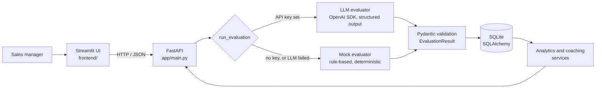

# CallFlow AI: LLM Sales QA and Lead Follow-up Copilot

> **CallFlow AI is a portfolio prototype that demonstrates how LLMs can support call-quality review, lead handling, CRM documentation, follow-up communication, and sales coaching. It uses fictional transcripts and does not represent deployment at a real call center.**

A sales manager pastes a call transcript from a (fictional) home-services call center. CallFlow AI scores the call against a nine-part QA rubric, extracts the lead into a CRM-ready record, drafts SMS and email follow-ups, stores the result, and rolls everything up into a dashboard and a coaching view.

It runs fully offline with a deterministic rule-based evaluator, and switches to an LLM (OpenAI, or any OpenAI-compatible provider such as Groq) when an API key is set.

---

## Contents

- [Features](#features)
- [Screenshots](#screenshots)
- [Architecture](#architecture)
- [Quick start](#quick-start)
- [Running with and without an API key](#running-with-and-without-an-api-key)
- [Run with Docker](#run-with-docker)
- [Demo data](#demo-data)
- [API](#api)
- [How evaluation works](#how-evaluation-works)
- [Tests](#tests)
- [Project structure](#project-structure)
- [Portfolio talking points](#portfolio-talking-points)
- [Limitations](#limitations)
- [Future improvements](#future-improvements)

---

## Features

**Evaluate a call**
- Paste or upload (`.txt`) a transcript, pick the business type (Roofing, HVAC, Plumbing, Generic Home Services), agent, and optional call date. Or load a demo: three one-click buttons, plus a dropdown with all 18 demo calls.
- Nine-category rubric, each scored 0–5, rolled into an overall score out of 100, with per-category feedback, strengths, missed opportunities, a coaching recommendation, and risk flags.
- **CRM record:** customer name, phone, email, location, service type, problem summary, urgency, lead temperature (Hot / Warm / Cold), appointment status, next action, and follow-up timing, plus an editable CRM note with a **Copy CRM note** button.
- **Follow-ups:** editable SMS (with character and segment count) and email (subject and body), each with a copy button. They thank the customer, reference their problem, confirm the next step, and include a call to action.

**Dashboard**
- Calls evaluated, average score, hot leads, appointments booked (with booking rate), and follow-ups needed (hot or warm leads without a booked appointment).
- Score trend (7-day rolling average plus daily averages), lead-temperature mix, calls by service type, agent performance table, and recent calls. Select a recent call to open it.
- Period selector: last 7 days, last 30 days, all time.

**Call history**
- Filters for date range, agent, service type, lead temperature, appointment booked, and minimum score.
- Select a row to open the full evaluation: scorecard, CRM record, follow-ups, transcript. The open call is kept in the URL (`/history?id=12`), so it can be linked to directly.

**Coaching**
- **Recurring gaps:** rubric categories that scored 2/5 or lower on at least two calls, with how often, which agents, a coaching tip, and links to example calls.
- Agent × rubric heatmap.
- Coaching plan per agent: up to three focus areas (categories averaging under 3/5), a tip for the weakest, and a strength if one averages 4/5 or more.

**Throughout**
- Mock mode is labelled in the sidebar, in a banner, and on every result. Each stored evaluation records whether it came from the LLM or the mock evaluator.
- If the LLM call fails (bad key, rate limit, timeout, invalid output), the app falls back to the mock evaluator and tells you why.
- All people, companies, addresses, phone numbers (`555-01xx`), and emails (`example.com`) are fictional, and the UI says so.

## Screenshots

> _Placeholder: add screenshots to `docs/screenshots/` and they will render here._

| Page | Screenshot |
|---|---|
| Evaluate call: scorecard | `docs/screenshots/evaluate-scorecard.png` |
| Evaluate call: CRM record and follow-ups | `docs/screenshots/evaluate-followups.png` |
| Dashboard | `docs/screenshots/dashboard.png` |
| Call history with a call open | `docs/screenshots/history.png` |
| Coaching | `docs/screenshots/coaching.png` |
| Swagger API docs | `docs/screenshots/api-docs.png` |

<!-- Example, once the files exist:

-->

## Architecture



- **Frontend (Streamlit)** talks to the backend only through its REST API (`frontend/api_client.py`), the same API a CRM or another client could use.
- **Backend (FastAPI)** validates input, runs the evaluator, stores results, and serves dashboard and coaching aggregates. Swagger docs are at `/docs`.
- **Evaluators** share one contract, `EvaluationResult` (Pydantic). The LLM's output is validated against it exactly like the mock's, and the overall score is always recomputed from the rubric rather than trusted from the model.
- **Storage** is SQLite via SQLAlchemy: `call_evaluations` plus `rubric_scores` (one row per category per call), which makes cross-call coaching queries simple.

## Quick start

Requires **Python 3.11+**.

```bash
git clone <your-repo-url> callflow-ai
cd callflow-ai

python3 -m venv .venv
source .venv/bin/activate          # Windows: .venv\Scripts\activate
pip install -r requirements.txt

cp .env.example .env               # works as-is: mock mode, demo data on
```

Start the API and the UI in two terminals:

```bash
# Terminal 1: API on http://localhost:8000 (docs at /docs)
uvicorn app.main:app --reload

# Terminal 2: UI on http://localhost:8501
streamlit run frontend/streamlit_app.py
```

With `SEED_DEMO_DATA=true` (the default in `.env.example`), the API loads 18 fictional demo calls the first time it starts against an empty database, so the dashboard and coaching pages have data immediately.

## Running with and without an API key

**Without a key (default).** Leave `OPENAI_API_KEY` blank. Every call is scored by the deterministic mock evaluator: no network calls, no cost, same input gives the same output. The UI shows **Mock evaluation mode** in the sidebar and a banner, and each result carries a **Mock evaluation** badge.

**With a key.** The LLM path uses the official OpenAI Python SDK with structured output, so it works with OpenAI and with OpenAI-compatible providers. Set these in `.env` and restart the API:

| Provider | `OPENAI_API_KEY` | `OPENAI_BASE_URL` | `OPENAI_MODEL` |
|---|---|---|---|
| OpenAI | `sk-...` | _(blank)_ | `gpt-4o-mini` |
| Groq | `gsk_...` | `https://api.groq.com/openai/v1` | `openai/gpt-oss-120b` |
| xAI | `xai-...` | `https://api.x.ai/v1` | a Grok model id from xAI's docs |

The sidebar then shows **AI evaluation · provider · model**, and `GET /health` reports the same.

If an LLM call fails, the evaluation still completes with the mock evaluator, is stored as `mock`, and the UI shows the reason. For example: _"AI evaluation failed: the Groq rate limit or account quota was exceeded (wait a minute and try again). Showing the mock (rule-based) evaluation instead."_ Free tiers have low per-minute token limits (Groq's free plan fits about two evaluations a minute).

> Secrets are read only from environment variables. `.env` is git-ignored; never commit a real key.

## Run with Docker

```bash
cp .env.example .env               # optional: add an API key here
docker compose up --build
```

- UI: http://localhost:8501
- API docs: http://localhost:8000/docs

Requires Docker Compose v2.24 or newer. Both services are built from one image. The database lives on the `callflow-data` volume, and demo data loads on first start (set `SEED_DEMO_DATA=false` to start empty). `docker compose down -v` deletes the volume and its data.

## Demo data

Three featured transcripts are one click away on the Evaluate page:

| Demo | What it shows | Mock score |
|---|---|---|
| Roofing: storm leak | Agent qualifies location and urgency, communicates value, books an inspection | 98 |
| HVAC: AC not cooling | Few discovery questions, no appointment request, customer told to call back | 22 |
| Plumbing: price objection | Agent handles the cost concern, offers a free inspection, sets a callback | 91 |

The seed set adds 15 more calls across four agents and three weeks, with deliberate patterns so the dashboard and coaching pages have something real to find:
- **Maya:** consistently strong.
- **Priya:** solid.
- **Chris:** books calls but skips value and objection handling.
- **Jake:** rarely asks for the appointment.

```bash
python -m scripts.seed_demo              # add demo calls if the database is empty
python -m scripts.seed_demo --reset      # delete ALL evaluations, then reload
python -m scripts.seed_demo --keep-dates # keep original dates (default shifts them to end today)
```

Demo calls are scored by the mock evaluator, so seeding is instant and free. They're stored and labelled as mock.

**Try any of them live.** On the Evaluate page, the **"Or pick any of the 18 demo calls"** dropdown loads a transcript with its agent and business type, ready to evaluate (with the LLM, if a key is set). The same transcripts are in [`sample_calls/`](sample_calls/) as `.txt` files for the upload box, with an index of agents, business types, and scenarios. Regenerate them after editing `app/seed_data.py` with `python -m scripts.export_sample_calls`.

## API

Interactive docs: **http://localhost:8000/docs**

| Method | Endpoint | Purpose |
|---|---|---|
| `POST` | `/api/evaluations` | Evaluate and store a transcript |
| `GET` | `/api/evaluations` | List evaluations (filters below), newest call first |
| `GET` | `/api/evaluations/{id}` | One evaluation with rubric, CRM fields, and follow-ups |
| `GET` | `/api/dashboard/metrics` | Headline metrics |
| `GET` | `/api/dashboard/analytics` | Score trend, service types, lead mix, per-agent stats |
| `GET` | `/api/coaching/insights` | Recurring gaps, category averages, per-agent focus areas |
| `GET` | `/health` | Status and evaluation mode (`mock` or `llm`, with provider and model) |

The list, dashboard, and coaching endpoints share the same optional filters: `start_date`, `end_date`, `agent_name` (partial, case-insensitive), `business_type`, `service_type`, `lead_temperature`, `appointment_booked`, `min_score`. The list also takes `limit` and `offset`.

**Evaluate a transcript**

```bash
curl -s -X POST http://localhost:8000/api/evaluations \
  -H "Content-Type: application/json" \
  -d '{
    "business_type": "Plumbing",
    "agent_name": "Sam Lee",
    "call_date": "2026-10-14",
    "transcript": "Agent: Thanks for calling Summit Plumbing, this is Sam. How can I help?\nCustomer: Hi, my name is Alex Kim. My water heater stopped working this morning.\nAgent: Sorry to hear that, Alex. What'\''s the address, and the best number to reach you?\nCustomer: 22 Birch Lane, Lakeview Springs. (512) 555-0110.\nAgent: We can send a technician today at 4 p.m. You'\''re all set, and you'\''ll get a text confirmation."
  }'
```

Response (`201`, abridged):

```json
{
  "id": 19,
  "evaluation_mode": "mock",
  "notice": null,
  "customer_name": "Alex Kim",
  "customer_phone": "(512) 555-0110",
  "service_type": "Water heater service",
  "urgency": "High",
  "lead_temperature": "Hot",
  "appointment_booked": true,
  "appointment_time": "Today at 4 PM",
  "overall_score": 67,
  "rubric_scores": [
    {"category": "Opening and rapport", "score": 5, "feedback": "Included a greeting, an agent introduction and empathy for the customer's situation."},
    {"category": "Lead qualification", "score": 3, "feedback": "Confirmed customer name, callback number and service address. Did not confirm email and homeownership."}
  ],
  "recommended_next_action": "Send the appointment confirmation for today at 4 PM and brief the technician on the water heater service request.",
  "sms_follow_up": "Hi Alex, thanks for calling Summit Plumbing about your water heater service. You're confirmed for today at 4 PM. Questions? Call (512) 555-0199."
}
```

**Find hot leads that weren't booked**

```bash
curl -s "http://localhost:8000/api/evaluations?lead_temperature=Hot&appointment_booked=false"
```

**Dashboard metrics for one agent since a date**

```bash
curl -s "http://localhost:8000/api/dashboard/metrics?agent_name=jake&start_date=2026-10-01"
```

Example response (numbers depend on your data; seeding shifts demo dates to end today):

```json
{"total_calls": 3, "average_score": 26.0, "hot_leads": 2, "appointments_booked": 0,
 "booking_rate": 0.0, "follow_ups_needed": 3, "low_score_calls": 3}
```

**Coaching insights**

```bash
curl -s http://localhost:8000/api/coaching/insights
```

Returns `recurring_gaps` (each with `gap_calls`, `gap_rate`, affected `agents`, a `coaching_tip`, and example calls), `category_insights` (weakest first), and `agents` (each with `focus_areas`, `strongest_area`, and a `coaching_tip`).

## How evaluation works

**Rubric.** Nine categories, each 0–5:

1. Opening and rapport
2. Lead qualification
3. Problem discovery
4. Service-area and urgency confirmation
5. Value communication
6. Objection handling
7. Appointment booking attempt
8. Clear next step
9. Professional communication

Overall score = total / 45 × 100, rounded. Bands: **80+** strong call, **60–79** needs coaching, **under 60** at risk.

**LLM path** (`app/services/evaluator.py`)
- **Structured output:** the transcript is sent with a system prompt that defines the rubric, the extraction rules (use `null` rather than invent details), and the lead and urgency definitions. The model must answer in a Pydantic schema via `chat.completions.parse`.
- **Prompt injection:** the transcript is wrapped in `<transcript>` tags, and the model is told it is data, not instructions.
- **Validation:** the response is validated again against `EvaluationResult`. Scores must be 0–5, all nine categories must be present exactly once, and enums must be valid.
- **Overall score:** recomputed from the category scores rather than trusted from the model.
- **Failures:** any API error, refusal, or validation failure falls back to the mock evaluator, with a readable reason.

**Mock path** (`app/services/mock_evaluator.py`)
- **How it scores:** it splits agent and customer turns, then looks for concrete behaviours, such as asking for an address, mentioning a warranty, offering two time slots, or confirming the next step. It also extracts contact details with regular expressions.
- **What it's for:** it's deterministic and fully tested, so it works offline, as a safety net, and for seeding data. It's a heuristic, not a substitute for an LLM or for human review.

## Tests

```bash
pytest -q
```

103 tests, no network or API key needed:

| File | Covers |
|---|---|
| `test_mock_evaluator.py` | Scores and extraction for the demo calls, speaker parsing, edge cases |
| `test_llm_evaluator.py` | LLM path with a fake client: valid output, each API failure type, invalid scores, missing categories, refusals, fallback notices, strict-schema compatibility |
| `test_api.py` | Create, fetch, list, filters, pagination, validation errors, health |
| `test_dashboard.py` | Metrics and analytics checked against aggregates computed independently in Python |
| `test_coaching.py` | Gap detection, thresholds, ordering, per-agent focus areas, endpoint filters |
| `test_seeding.py` | Seed and reset, date shifting, startup seeding, CLI |
| `test_frontend.py` | Streamlit pages run headlessly (`AppTest`): evaluate flow, history filters and deep links, dashboard, coaching, chart rendering, copy-button escaping |
| `test_models.py` | Persistence, cascade deletes, result and request validation |

## Project structure

```
callflow-ai/
├── app/
│   ├── main.py               # FastAPI app, /health, startup (create tables, optional demo seed)
│   ├── config.py             # settings from environment / .env
│   ├── database.py           # SQLAlchemy engine and session
│   ├── models.py             # CallEvaluation, RubricScore
│   ├── schemas.py            # Pydantic request/response models, rubric, coaching tips
│   ├── filters.py            # shared query filters (list, dashboard, coaching)
│   ├── sample_data.py        # the three featured demo transcripts
│   ├── seed_data.py          # the full 18-call demo dataset
│   ├── routers/
│   │   ├── evaluations.py    # POST/GET /api/evaluations
│   │   ├── dashboard.py      # /api/dashboard/metrics, /analytics
│   │   └── coaching.py       # /api/coaching/insights
│   └── services/
│       ├── evaluator.py      # LLM evaluator and mock fallback
│       ├── mock_evaluator.py # deterministic rule-based evaluator
│       ├── analytics.py      # dashboard aggregates (SQL)
│       ├── coaching.py       # recurring gaps and agent focus areas
│       └── seeding.py        # load the demo dataset
├── frontend/
│   ├── streamlit_app.py      # entry point and navigation
│   ├── pages.py              # page definitions
│   ├── api_client.py         # HTTP client for the backend
│   ├── result_view.py        # scorecard / CRM / follow-ups / transcript tabs
│   ├── charts.py             # Altair charts
│   ├── ui.py                 # styling, cards, copy button, status banners
│   └── views/                # evaluate, dashboard, history, coaching
├── scripts/
│   ├── seed_demo.py          # python -m scripts.seed_demo
│   └── export_sample_calls.py # writes sample_calls/ from the demo dataset
├── sample_calls/             # the 18 demo transcripts as .txt files
├── tests/
├── .streamlit/config.toml    # theme: dark blue, white, green accents
├── Dockerfile
├── docker-compose.yml
├── requirements.txt
├── .env.example
└── README.md
```

## Portfolio talking points

**CallFlow AI: LLM Sales QA and Lead Follow-up Copilot.** Built a portfolio prototype that evaluates home-services sales calls against a configurable rubric, generates CRM-ready summaries and personalized follow-ups, and surfaces manager metrics for quality and booking performance.

> _"I built this to show how I would approach a call-center automation problem: start with the operational workflow, make the AI output structured and reviewable, then connect it to follow-up and reporting."_

Things worth discussing, and that the code backs up:
- **The AI output is a contract, not free text.**
  - Every evaluation, LLM or mock, passes the same Pydantic schema before it's stored.
  - The overall score is recalculated from the rubric, so the model can't report a total that doesn't match its own category scores.
- **It degrades gracefully.** Missing key, bad key, rate limit, timeout, malformed output: the user still gets a result, a clear explanation, and an honest label saying which evaluator produced it.
- **Reviewable, not autonomous.** CRM notes and follow-ups are drafts a person edits and copies. Nothing is sent automatically.
- **Analytics on structured data.** Because rubric scores are stored per category, coaching insights are straightforward queries. For example: which categories score 2 or lower across many calls, and for which agents.
- **Provider-agnostic.** The same code runs against OpenAI or OpenAI-compatible APIs (tested live with Groq) by changing environment variables.
- **Tested.** 103 tests, including the LLM failure paths (with a fake client) and the Streamlit pages (headless).

Be accurate about scope:
- It is a prototype with fictional data. It hasn't been used at a real call center and has no measured business results.
- The demo dataset is scored by the rule-based evaluator, not by an LLM.

## Limitations

- **Transcripts only.** No audio or speech-to-text. Speaker labels (`Agent:` / `Customer:`) give the best results.
- **The mock evaluator is keyword-based.** It rewards the presence of behaviours and can't judge tone or nuance. The LLM path is better at this, but its scores still vary between runs and models.
- **No accuracy benchmark.** LLM scores haven't been compared with human QA reviewers.
- **Single-user and local.** No authentication, roles, or multi-tenant separation. SQLite suits a demo, not concurrent production use.
- **Follow-ups are drafts only.** No SMS or email sending, and no CRM integration.

## Future improvements

- **Audio input:** upload a call recording, transcribe it, and separate the speakers.
- **Calibration set:** a set of human-scored calls to measure LLM agreement, catch prompt regressions in CI, and compare models.
- **Configurable rubric:** edit categories, weights, and guidance per business type in the UI rather than in code.
- **Integrations:** push notes and follow-ups to a CRM (e.g. HubSpot, ServiceTitan) and send through Twilio or SendGrid, with an approval step.
- **Accounts:** authentication and roles (agent, manager, owner), with agents seeing only their own calls.
- **Production database:** Postgres with Alembic migrations.
- **Async evaluation:** a job queue, so long transcripts and batch uploads don't block the request.
- **Coaching over time:** agent progress against their focus areas, and manager notes.
